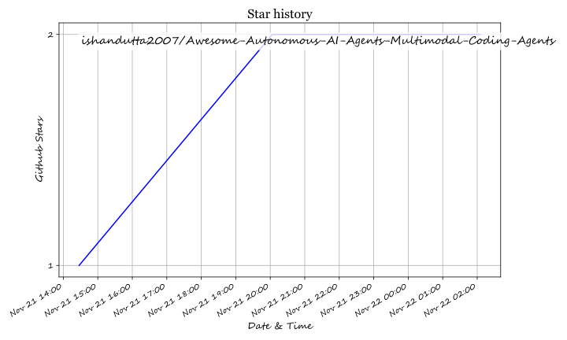

# Awesome-Autonomous-AI-Agents-Multimodal-Coding-Agents

# Awesome-Autonomous-AI-Agents-Multimodal-Coding-Agents

## Top Autonomous AI Agents & Multimodal Coding Agents Ecosystem

**Curated List of SaaS/Hosted Platforms & Open-Source GitHub Projects**  

*Focused on Autonomous Software Engineering Agents, Multimodal Coding Assistants, Browser/Terminal Executors & Self-Hosted Agent Frameworks*  

**Last updated: November 2026**

This repository tracks notable **SaaS/hosted platforms** and **open-source projects** for **Autonomous AI Agents & Multimodal Coding Agents**. These tools plan, write, debug, test, refactor, browse, and ship full-stack software autonomously across terminals, IDEs, sandboxed Docker containers, and web browsers using frontier LLMs, vision-language models, and tool-use loops.

**Examples** include Devin by Cognition, OpenHands, SWE-agent, GitHub Copilot Workspace, Factory Code, Goose, Replit Agent, Magic.dev, Augment Code, Cosine Genie, and kortix-ai/suna (the category leaders and popular runtimes). 

**Open-source emphasis**: This section is heavily expanded with every major active project for self-hosted autonomous coding agents, generalist browser/computer-use agents, terminal coding CLIs, and SWE-bench-verified agent harnesses — ideal for software engineers, AI researchers, DevOps teams, and developers building transparent, local-first autonomous engineering workflows.

Contributions welcome! Open a PR to add/update entries. Keep descriptions factual and link to official sites.

## Table of Contents

- [SaaS/Hosted Platforms](#saashosted-platforms)

- [Open-Source GitHub Projects](#open-source-github-projects)

- [How to Contribute](#how-to-contribute)

- [Disclaimer](#disclaimer)

## SaaS/Hosted Platforms

| Platform / Tool | Description | Pricing (Starting Tier) | Free Tier / Trial Limits | Company Valuation / Revenue (Scale) |
| :--- | :--- | :--- | :--- | :--- |
| **[GitHub Copilot Workspace](https://github.com)** | Task-centric cloud coding environment integrated into GitHub repositories that transforms issues into step-by-step specifications, multi-file plans, and pull requests. | **$10 / month** (Copilot Pro) or $19 / user / month (Business) | **Free Forever**: 2,000 code completions/month & 50 chat/workspace requests/month; free for verified students | **~$3.7 Trillion** market cap (Parent: Microsoft; Copilot ARR: ~$1B) |
| **[Claude Code (Anthropic)](https://anthropic.com)** | Agentic terminal and cloud coding tool that searches codebases, edits files, executes test suites, and manages Git workflows directly from natural language instructions. | **$20 / month** (Claude Pro) or pay-as-you-go API consumption | **Free Trial Only**: No free subscription tier; new Anthropic Console API accounts receive a one-time **$5 free credit** grant (phone verification required) | **~$1.5 Trillion** market cap / valuation (Anthropic; ARR: >$65B) |
| **[Cursor (Background Agents)](https://cursor.com)** | AI-first code editor featuring autonomous cloud background agents capable of running isolated tasks, inspecting UI screenshots, and opening pull requests asynchronously. | **$20 / month** (Pro Plan) | **Free Forever**: 2,000 Tab code completions/month + 50 slow/premium requests/month | **~$60 Billion** valuation (Acquired by SpaceX/SpaceXAI; ARR: ~$4B) |
| **[Devin (Cognition AI)](https://cognition.ai)** | Autonomous AI software engineer equipped with its own cloud shell, code editor, and browser to plan, execute, debug, and deploy full engineering tasks end-to-end. | **$20 / month** (Pro Plan) | **Free Forever**: Unlimited inline edits & Tab completions + light daily/weekly agent interaction quota | **~$48 Billion** valuation (Cognition AI Series E) |
| **[Replit Agent](https://replit.com)** | Cloud IDE autonomous agent that scaffolds, builds, configures databases, debugs, and deploys full-stack web applications from natural language and visual screenshots. | **$20 / month** (Replit Core with $25/mo Agent credits) | **Free Forever**: Daily refreshing Agent credits quota for evaluation + 1 published app deployment | **~$9 Billion** valuation (Replit Series D; ARR: ~$500M) |
| **[Magic.dev](https://magic.dev)** | Frontier AI coding platform leveraging ultra-long-context neural architectures to reason across entire repositories, documentation, and complex refactoring tasks. | Custom quote-based enterprise contract (Developer preview via invite) | **Free Trial / Preview Only**: Early-access waitlist / preview trial granted upon registration and cohort onboarding | **~$2.9 Billion** valuation (CapitalG/Sequoia backed) |
| **[Factory (Droids / Factory Code)](https://factory.ai)** | Enterprise autonomous software development platform deploying specialized AI agents ("Droids") for code generation, migration, PR review, and incident triage. | **$20 / month** (Pro Plan) | **Free Forever (BYOK)**: Droid CLI free with Bring Your Own API Key; managed platform provides promotional signup credits/tokens (no standard free days) | **~$1.5 Billion** valuation (Factory Series C) |
| **[Augment Code](https://augmentcode.com)** | Context-aware enterprise AI coding assistant and autonomous agent engineered for massive multi-repository codebases with deep architectural retrieval. | **$20 / month** (Indie Plan) | **Free Trial Only**: 14-day free trial with full feature access and up to 600 messages / 30,000 credits pool | **~$977 Million** valuation (Series B; ARR: ~$20M) |
| **[Cosine (Genie)](https://cosine.sh)** | Autonomous AI software engineering platform trained on human developer workflows to resolve GitHub issues, write tests, and submit production pull requests. | **$19 / month** (Starter Plan with 4M credits) | **Free Trial Only**: No permanent free tier; paid Starter tier ($19/mo) required for live agent evaluation | **~$8 Million+** funding raised (YC backed, early-stage private) |

## Open-Source GitHub Projects

- **[OpenHands (formerly OpenDevin)](https://github.com)**  

  Leading open-source platform for autonomous AI software development agents equipped with a sandboxed bash shell, code editor, and headless browser for end-to-end engineering.

- **[kortix-ai/suna](https://github.com)**  

  Open-source generalist autonomous AI agent platform combining browser automation, file management, code execution, web search, and real-time multimodal task orchestration.

- **[SWE-agent (Princeton NLP)](https://github.com)**  

  Foundational open-source autonomous software engineering agent featuring a custom Agent-Computer Interface (ACI) designed to autonomously fix real GitHub issues.

- **[Goose (Block)](https://github.com)**  

  Extensible open-source on-machine AI agent built in Rust that automates engineering tasks, executes shell commands, edits code, and integrates natively with Model Context Protocol (MCP) servers.

- **[Aider](https://github.com)**  

  Popular open-source AI pair-programming CLI tool supporting multimodal image/screenshot inputs, whole-repo Git mapping, automated linting/testing loops, and local or cloud LLMs.

- **[Cline (formerly Claude Dev)](https://github.com)**  

  Autonomous open-source IDE coding agent capable of creating/editing files, running terminal commands, launching headless browsers for visual UI verification, and using MCP tools.

- **[Roo Code (formerly Roo Cline)](https://github.com)**  

  Open-source autonomous multi-mode AI coding agent for VS Code supporting custom Architect, Code, Debug, and Orchestrator personas with granular tool permissions.

- **[OpenCode (`sst/opencode`)](https://github.com)**  

  Fast, open-source terminal-based AI coding agent built for multi-provider LLM orchestration, LSP-powered code intelligence, and interactive autonomous sessions.

- **[GPT-Engineer (`gpt-engineer-org/gpt-engineer`)](https://github.com)**  

  Open-source CLI tool that generates entire codebases from natural language prompts, asks clarifying architectural questions, and iteratively improves existing projects.

- **[MetaGPT](https://github.com)**  

  Multi-agent open-source software company framework assigning Product Manager, Architect, Project Manager, and Engineer roles to generate PRDs, system designs, and code.

- **[Browser Use](https://github.com)**  

  Open-source multimodal web-browsing agent library enabling AI coding and research agents to visually inspect rendered web apps, click elements, and verify frontend UIs.

### Additional Strong Open-Source Options

- **[SWE-smith & SWE-gym](https://github.com)** for generating synthetic software engineering environments and training open-weight autonomous coding agents.

- **[Continue (`continuedev/continue`)](https://github.com)** for open-source IDE autocomplete, chat, and customizable agentic workflows powered by local Ollama or cloud models.

- **[Plandex](https://github.com)** for an open-source terminal-based AI coding engine built for large multi-file tasks with cumulative diff review sandboxes.

- **[Agentless](https://github.com)** for a streamlined, non-agentic three-phase (localization, repair, validation) open-source approach to automated software issue resolution.

- **[E2B Code Interpreter SDK](https://github.com)** for open-source secure cloud microVM sandboxes engineered specifically for running untrusted AI-generated code safely.

**Frameworks for building custom systems**: Combine **OpenHands** or **kortix-ai/suna** for full sandboxed autonomous execution, **Browser Use** for multimodal visual UI testing, and **Goose** or **Cline** + **MCP servers** for local developer workstations.

## How to Contribute

1. Fork the repo.

2. Add/edit entries in `README.md` (follow existing format).

3. Include: name, link, 1–2 sentence description, and whether it's SaaS/hosted or open-source.

4. Submit PR with a short explanation.

Star the repo if you find it useful!

## Disclaimer

- This is a **community-curated** list — not exhaustive and not an endorsement.

- Autonomous AI coding agents execute arbitrary shell commands, modify Git histories, and access network endpoints; always run them inside isolated Docker containers, microVMs, or dedicated sandbox environments.

- Review all AI-generated pull requests, dependency additions, and infrastructure changes before merging into production repositories.

---

**Made for software engineers, AI agent researchers, DevOps architects, and open-source contributors.**  

Let's make autonomous software engineering more open, transparent, and developer-controlled.

## ⭐ Star History

<a href="https://star-history.com/#ishandutta2007/Awesome-Autonomous-AI-Agents-Multimodal-Coding-Agents&Timeline" align="center">
  <picture>
    <source media="(prefers-color-scheme: dark)" srcset="assets/ishandutta2007_Awesome-Autonomous-AI-Agents-Multimodal-Coding-Agents_growth.svg">
    
  </picture>
</a>
