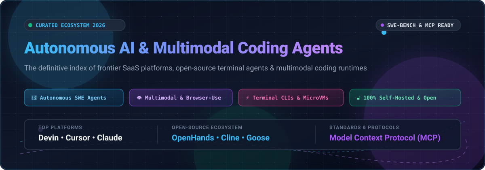

# 🤖 Awesome Autonomous AI Agents & Multimodal Coding Agents

  

  
  
  
  
  
  

---

## 🌟 Overview & Highlights

A curated directory and resource hub indexing top **Autonomous Software Engineering (SWE) Agents**, **Multimodal Coding Assistants**, **Terminal AI Agents**, and **Self-Hosted Open-Source Frameworks**. 

Whether you are looking for enterprise cloud agents like **Devin**, **Claude Code**, and **GitHub Copilot Workspace**, or local, privacy-first open-source runtimes like **OpenHands**, **Browser Use**, **Cline**, and **Goose**, this guide compares capabilities, pricing tiers, free tier quotas, and architectural features.

> 📅 **Last Curated & Verified:** November 2026  
> 🏷️ **Keywords / Topics:** `ai-agents`, `coding-agents`, `autonomous-agents`, `multimodal`, `llm`, `software-engineering`, `mcp-protocol`, `agentic-workflows`, `swe-bench`, `computer-use`

---

## 📑 Table of Contents

- [📊 Sector Overview & Market Dynamics](#-sector-overview--market-dynamics)
- [💼 SaaS & Hosted Autonomous Platforms](#-saas--hosted-autonomous-platforms)
- [🔓 Open-Source GitHub Projects](#-open-source-github-projects)
- [🛠️ Architecture & Runtimes Comparison](#️-architecture--runtimes-comparison)
- [🤝 How to Contribute](#-how-to-contribute)
- [💖 Support & Sponsorship](#-support--sponsorship)
- [⚠️ Disclaimer & Security](#️-disclaimer--security)
- [⭐ Star History](#-star-history)

---

## 📊 Sector Overview & Market Dynamics

The autonomous AI coding assistants and agentic software engineering sector is estimated at **$7.5B–$8.5B in 2025** and projected to surge past **$10B–$11B by 2026** (growing at a rapid CAGR of >35%). Market dynamics reflect a **moderately concentrated, bifurcated structure**: an oligopolistic top tier dominated by frontier ecosystem leaders (Microsoft/GitHub Copilot, Cursor, Cognition/Devin, and Anthropic/Claude Code) capturing massive recurring revenue and enterprise mindshare, alongside a **highly vibrant, fragmented long-tail** of open-source CLI tools, MCP-native agents, and specialized local runtimes competing on data sovereignty, deep customization, and cost transparency.

---

## 💼 SaaS & Hosted Autonomous Platforms

| Platform / Tool | Description | Pricing (Starting Tier) | Free Tier / Trial Limits | Company Valuation / Revenue (Scale) |
| :--- | :--- | :--- | :--- | :--- |
| **[GitHub Copilot Workspace](https://github.com)** | Task-centric cloud coding environment integrated into GitHub repositories that transforms issues into step-by-step specifications, multi-file plans, and pull requests. | **$10 / month** (Copilot Pro) or $19 / user / month (Business) | **Free Forever**: 2,000 code completions/month & 50 chat/workspace requests/month; free for verified students | **~$3.7 Trillion** market cap (Parent: Microsoft; Copilot ARR: ~$1B) |
| **[Claude Code (Anthropic)](https://anthropic.com)** | Agentic terminal and cloud coding tool that searches codebases, edits files, executes test suites, and manages Git workflows directly from natural language instructions. | **$20 / month** (Claude Pro) or pay-as-you-go API consumption | **Free Trial Only**: No free subscription tier; new Anthropic Console API accounts receive a one-time **$5 free credit** grant (phone verification required) | **~$1.5 Trillion** market cap / valuation (Anthropic; ARR: >$65B) |
| **[Cursor (Background Agents)](https://cursor.com)** | AI-first code editor featuring autonomous cloud background agents capable of running isolated tasks, inspecting UI screenshots, and opening pull requests asynchronously. | **$20 / month** (Pro Plan) | **Free Forever**: 2,000 Tab code completions/month + 50 slow/premium requests/month | **~$60 Billion** valuation (Acquired by SpaceX/SpaceXAI; ARR: ~$4B) |
| **[Devin (Cognition AI)](https://cognition.ai)** | Autonomous AI software engineer equipped with its own cloud shell, code editor, and browser to plan, execute, debug, and deploy full engineering tasks end-to-end. | **$20 / month** (Pro Plan) | **Free Forever**: Unlimited inline edits & Tab completions + light daily/weekly agent interaction quota | **~$48 Billion** valuation (Cognition AI Series E) |
| **[Replit Agent](https://replit.com)** | Cloud IDE autonomous agent that scaffolds, builds, configures databases, debugs, and deploys full-stack web applications from natural language and visual screenshots. | **$20 / month** (Replit Core with $25/mo Agent credits) | **Free Forever**: Daily refreshing Agent credits quota for evaluation + 1 published app deployment | **~$9 Billion** valuation (Replit Series D; ARR: ~$500M) |
| **[Magic.dev](https://magic.dev)** | Frontier AI coding platform leveraging ultra-long-context neural architectures to reason across entire repositories, documentation, and complex refactoring tasks. | Custom quote-based enterprise contract (Developer preview via invite) | **Free Trial / Preview Only**: Early-access waitlist / preview trial granted upon registration and cohort onboarding | **~$2.9 Billion** valuation (CapitalG/Sequoia backed) |
| **[Factory (Droids / Factory Code)](https://factory.ai)** | Enterprise autonomous software development platform deploying specialized AI agents ("Droids") for code generation, migration, PR review, and incident triage. | **$20 / month** (Pro Plan) | **Free Forever (BYOK)**: Droid CLI free with Bring Your Own API Key; managed platform provides promotional signup credits/tokens (no standard free days) | **~$1.5 Billion** valuation (Factory Series C) |
| **[Augment Code](https://augmentcode.com)** | Context-aware enterprise AI coding assistant and autonomous agent engineered for massive multi-repository codebases with deep architectural retrieval. | **$20 / month** (Indie Plan) | **Free Trial Only**: 14-day free trial with full feature access and up to 600 messages / 30,000 credits pool | **~$977 Million** valuation (Series B; ARR: ~$20M) |
| **[Cosine (Genie)](https://cosine.sh)** | Autonomous AI software engineering platform trained on human developer workflows to resolve GitHub issues, write tests, and submit production pull requests. | **$19 / month** (Starter Plan with 4M credits) | **Free Trial Only**: No permanent free tier; paid Starter tier ($19/mo) required for live agent evaluation | **~$8 Million+** funding raised (YC backed, early-stage private) |

---

## 🔓 Open-Source GitHub Projects

Curated list of self-hosted autonomous software engineering agents, multimodal computer-use frameworks, and CLI assistants—sorted in descending order by GitHub stargazers count:

1. **[OpenCode (`sst/opencode`)](https://github.com/sst/opencode)**   
   ⚡ Ultra-fast, open-source terminal-based AI coding assistant and agent built for multi-provider LLM orchestration, LSP-powered code intelligence, and seamless developer terminal sessions.

2. **[AutoGPT (`Significant-Gravitas/AutoGPT`)](https://github.com/Significant-Gravitas/AutoGPT)**   
   🧠 The vision of accessible AI for everyone: foundational autonomous agent platform orchestrating multi-agent systems, file systems, code execution, and modular agent blocks.

3. **[Browser Use (`browser-use/browser-use`)](https://github.com/browser-use/browser-use)**   
   🌐 Open-source multimodal web-browsing agent library enabling AI coding, scraping, and research agents to visually inspect web interfaces, click buttons, fill forms, and verify frontend UIs.

4. **[OpenHands (formerly OpenDevin)](https://github.com/All-Hands-AI/OpenHands)**   
   🛠️ Flagship open-source platform for autonomous AI software development agents equipped with sandboxed bash terminals, file managers, and headless browsers for end-to-end task execution.

5. **[Cline (formerly Claude Dev)](https://github.com/cline/cline)**   
   💻 Autonomous open-source IDE coding agent for VS Code capable of creating/editing files, executing terminal commands, launching browsers for UI inspection, and integrating Model Context Protocol (MCP) tools.

6. **[MetaGPT (`geekan/MetaGPT`)](https://github.com/geekan/MetaGPT)**   
   🏢 Multi-agent software company simulation framework assigning Product Manager, Architect, Project Manager, and Engineer roles to collaboratively generate PRDs, architecture designs, and production code.

7. **[Goose (`block/goose`)](https://github.com/block/goose)**   
   🪿 Extensible open-source on-machine AI agent built in Rust by Block that automates engineering tasks, executes shell commands, edits codebases, and integrates natively with Model Context Protocol (MCP) servers.

8. **[GPT-Engineer (`gpt-engineer-org/gpt-engineer`)](https://github.com/gpt-engineer-org/gpt-engineer)**   
   🏗️ Autonomous CLI tool that scaffolds whole codebases from natural language prompts, conducts clarifying Q&A interviews, and iteratively refactors existing software repositories.

9. **[Aider (`Aider-AI/aider`)](https://github.com/Aider-AI/aider)**   
   ⌨️ Premier terminal AI pair programming CLI with whole-repo Git mapping, multimodal image/screenshot inputs, automated linting/testing loops, and seamless local or cloud LLM backend support.

10. **[Khoj (`khoj-ai/khoj`)](https://github.com/khoj-ai/khoj)**   
    🔎 Open-source personal AI agent and research copilot capable of searching your local notes, documents, and codebases, executing deep internet searches, and building custom autonomous workflows.

11. **[Continue (`continuedev/continue`)](https://github.com/continuedev/continue)**   
    🔌 Open-source IDE extension bringing autocomplete, multi-file chat, custom slash commands, and agentic workflows to VS Code and JetBrains via local Ollama or cloud models.

12. **[ChatDev (`OpenBMB/ChatDev`)](https://github.com/OpenBMB/ChatDev)**   
    👥 Virtual software development company framework where multi-agent roles (CEO, CPO, CTO, Programmer, Reviewer, Tester) communicate through multi-agent chats to build custom software.

13. **[Roo Code (`RooVetGit/Roo-Code`)](https://github.com/RooVetGit/Roo-Code)**   
    🦘 Multi-mode autonomous AI coding agent for VS Code offering dedicated Architect, Code, Ask, and Debug personas with customizable system prompts and fine-grained tool approvals.

14. **[SWE-agent (`princeton-nlp/SWE-agent`)](https://github.com/princeton-nlp/SWE-agent)**   
    🔬 Princeton NLP's academic benchmark-setting autonomous software engineer introducing an Agent-Computer Interface (ACI) specifically optimized for LLMs to resolve real GitHub issues.

15. **[kortix-ai/suna](https://github.com/kortix-ai/suna)**   
    🧩 Generalist open-source autonomous agent blending browser automation, file operations, Python code execution, web search, and real-time multimodal task orchestration.

16. **[Devika (`stitionai/devika`)](https://github.com/stitionai/devika)**   
    🤖 Open-source autonomous AI software engineer designed as a transparent alternative to Devin, combining planning, research, coding, and web browsing capabilities.

17. **[Plandex (`plandex-ai/plandex`)](https://github.com/plandex-ai/plandex)**   
    📋 Terminal-based AI coding engine engineered for complex, multi-file software engineering tasks featuring cumulative sandboxed diffs and human-in-the-loop approvals.

18. **[E2B (`e2b-dev/E2B`)](https://github.com/e2b-dev/E2B)**   
    🛡️ Open-source secure cloud microVM sandboxes built specifically for AI agents to safely execute arbitrary code, launch browsers, and run untrusted workloads in isolation.

19. **[SWE-bench (`princeton-nlp/SWE-bench`)](https://github.com/princeton-nlp/SWE-bench)**   
    📏 The golden benchmark dataset and evaluation harness for autonomous software engineering agents evaluating end-to-end bug resolution on real-world Python repositories.

20. **[Agentless (`OpenAutoCoder/Agentless`)](https://github.com/OpenAutoCoder/Agentless)**   
    🎯 Highly cost-effective, non-agentic three-phase architecture (hierarchical localization, repair generation, and patch validation) for automated software issue fixing.

---

## 🛠️ Architecture & Runtimes Comparison

When selecting or architecting an autonomous software engineering agent system:

- 🐳 **Full Sandboxed Environments**: Use **[OpenHands](https://github.com/All-Hands-AI/OpenHands)** or **[E2B](https://github.com/e2b-dev/E2B)** for isolated Docker/microVM execution where agents can safely run bash scripts, compile packages, and spin up background daemons.
- 🌐 **Multimodal Visual Testing**: Pair with **[Browser Use](https://github.com/browser-use/browser-use)** to give agents eyes to inspect rendered frontend interfaces, assert DOM states, and verify web UI layouts.
- 💻 **Interactive Local Workstations**: Deploy **[Aider](https://github.com/Aider-AI/aider)**, **[Cline](https://github.com/cline/cline)**, or **[Goose](https://github.com/block/goose)** directly in your CLI or IDE with native **Model Context Protocol (MCP)** tool connections.
- 🧪 **Rigorous Validation**: Benchmark your agents on **[SWE-bench](https://github.com/princeton-nlp/SWE-bench)** or implement lightweight validation loops like **[Agentless](https://github.com/OpenAutoCoder/Agentless)** before committing patches to production.

---

## 🤝 How to Contribute

Contributions are warmly encouraged! To propose additions or updates:

1. 🍴 Fork this repository.
2. ✍️ Add your project or hosted service to `README.md` following the established format and star-badge link pattern.
3. 📝 Ensure descriptions remain concise, factual, and backed by working official documentation or repository links.
4. 🚀 Submit a Pull Request detailing the changes.

---

## 💖 Support & Sponsorship

If you find this curated ecosystem directory helpful for your development workflow, research, or architecture planning:

- ⭐ **Star this repository** to help others discover it!
- 🍴 **Fork and share** with colleagues and developer communities.
- ☕ **Buy me a coffee / Sponsor**: Support ongoing maintenance and curation via the **[GitHub Sponsors Dashboard](https://github.com/sponsors/ishandutta2007)**.

Thank you to all open-source contributors and autonomous AI builders! 🙌

---

## ⚠️ Disclaimer & Security

- This is a community-curated, educational index and does not represent an endorsement of any commercial platform or open-source repository.
- Autonomous coding agents execute arbitrary shell commands, manage Git state, and communicate over networks; **always run autonomous agents inside hardened Docker containers, disposable VMs, or sandboxed environments**.
- Carefully inspect all AI-generated code diffs, dependencies, and infrastructure definitions before deploying to production systems.

---

## ⭐ Star History

